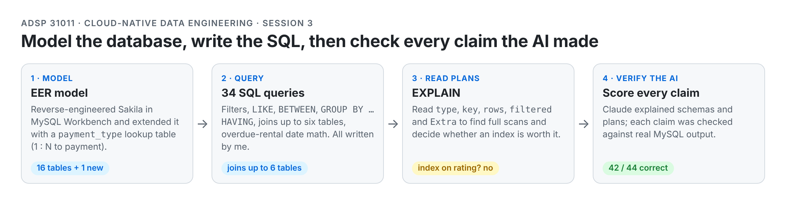
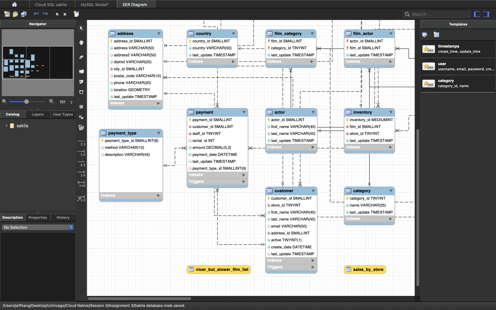
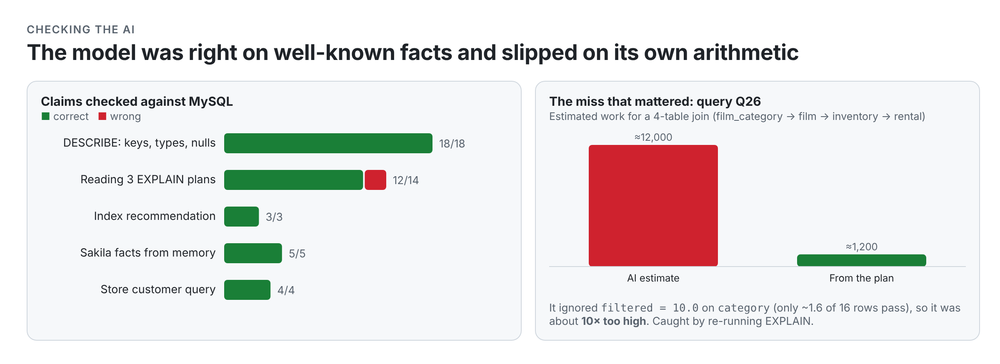

# Sakila: SQL Modeling & Query Plans

**Model the schema, write 34 queries, read the query plans, and then check every claim an AI made about all of it against the database itself.**

<picture>
  <source media="(prefers-color-scheme: dark)" srcset="assets/overview-dark.png">
  
</picture>

Built on the [Sakila](https://dev.mysql.com/doc/sakila/en/) DVD-rental database running on Google Cloud SQL for MySQL 8.0 (deployed with [cloud-sql-sakila-deploy](https://github.com/haokang-uchicago/cloud-sql-sakila-deploy)). Three parts:

| Part | What | Where |
|---|---|---|
| 1 · Relational modeling | Reverse-engineered Sakila into an EER model in MySQL Workbench, then extended it with a `payment_type` lookup table (1:N to `payment`) | `model/EER.png`, `model/sakila_model.mwb`, `model/relational_model.md` |
| 2 · SQL | 34 queries: filters, `LIKE`, `BETWEEN`, aggregates, `GROUP BY … HAVING`, `ORDER BY … LIMIT`, multi-table joins up to six tables, date arithmetic for overdue rentals | `sakila_sql.ipynb` / `.html` |
| 3 · SQL with Claude | `DESCRIBE`, `SHOW CREATE TABLE` and `EXPLAIN` read by Claude, then every claim scored against MySQL output | `sakila_sql.ipynb` (Part 3), `prompt_log.md` |



## How to read a plan (what Part 3 taught me)

| EXPLAIN column | What it tells you | Example from this repo |
|---|---|---|
| `type` | How a table is read: `ALL` (full scan) → `index` → `range` → `ref` → `eq_ref` → `const` | Q1 reads `film` with `type = ALL` (no index on `rating`) |
| `key` | Which index was actually used | Q26's join walks `film_category` → `film` → `inventory` → `rental` by primary/foreign keys |
| `rows` | Estimated rows examined | `film` = 1,000 · `category` = 16 |
| `filtered` | % of those rows expected to survive the `WHERE` | `category` filtered = 10.0 → only ~1.6 of 16 rows pass `name = 'Horror'` |
| `Extra` | `Using index` (covering), `Using temporary`, `Using where` | Q17 needs a temporary table for its `GROUP BY` |

**Should `film(rating)` get an index?** Probably not. `rating` has only 5 distinct values, Q1 needs 223 of 1,000 rows, and the query selects `title` and `description`, so MySQL would still look up every matching row. The index would cost one more B-tree update on every insert or update for little read benefit. (Not created; analysis only.)

## Checking the AI: scorecard

<picture>
  <source media="(prefers-color-scheme: dark)" srcset="assets/ai-scorecard-dark.png">
  
</picture>


| Task | Claims checked | Correct | What was wrong |
|---|---|---|---|
| Keys, nullability and types from `DESCRIBE` (payment, rental, film) | 18 | **18** | — (it correctly warned that `MUL` means "indexed", not "foreign key") |
| Reading three `EXPLAIN` plans | 14 | **12** | Estimated Q26's work as ≈12,000 row combinations, ignoring `filtered = 10.0` on `category`, so it was **about 10× too high** (≈1,200). It also missed `Using index` on three tables. Caught by re-running `EXPLAIN` showing only `filtered` and `Extra`. |
| Index recommendation | 3 | **3** | — |
| Five Sakila facts "from memory" (films, customers, top rating, payment dates, categories) | 5 | **5** | Miscalibrated: it said the timestamps were most likely wrong, and they matched to the second |
| "Which store has more customers?" query | 4 | **4** | — (store 1 Lethbridge 326, store 2 Woodridge 273, total 599) |

The lesson: the model was right on facts that appear all over the internet and slipped on arithmetic it had to do itself. Its confidence didn't track its accuracy, so every number gets a check query.

## Run it

```bash
pip install pandas pymysql "cloud-sql-python-connector[pymysql]"
export CONNECTION_NAME="project:region:instance"   # from your env.sh; never in the notebook
export MYSQL_ROOT_PW="..."
jupyter lab sakila_sql.ipynb                       # Restart & Run All
```

No password or project id is stored in the notebook; both come from environment variables.

## Repo layout

```
sakila-sql-modeling-and-query-plans/
├── sakila_sql.ipynb / .html     Parts 2 and 3 (34 queries, DESCRIBE/EXPLAIN analysis, verification tables)
├── model/
│   ├── EER.png                  EER diagram with the payment_type extension
│   ├── sakila_model.mwb         MySQL Workbench model
│   └── relational_model.md      payment table: keys, cardinalities, AI-use disclosure
└── prompt_log.md                every prompt to Claude, its answer, and how it was verified
```

## Context

Built for **ADSP 31011 Cloud-Native Data Engineering** (UChicago MS in Applied Data Science, Autumn 2026). All 34 queries in Part 2 were written by me; Claude explained concepts and reviewed them. Part 3 used Claude as required, with every claim verified in MySQL. Published with the instructor's permission to showcase the work.

**Hao Kang** · [LinkedIn](https://www.linkedin.com/in/hao-kang-6654b5331/) · [GitHub](https://github.com/haokang-uchicago)
