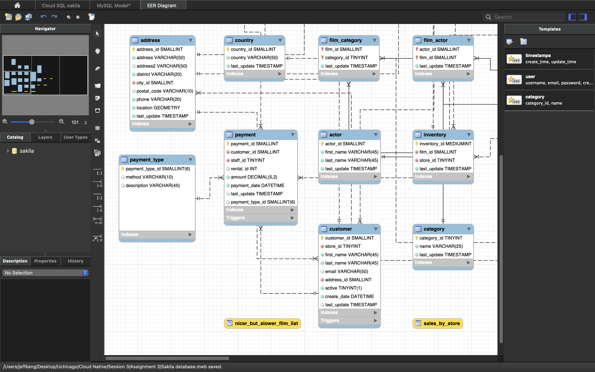

# Relational model: Sakila `payment` with a `payment_type` lookup

The Sakila schema on Cloud SQL for MySQL was reverse-engineered in MySQL Workbench 8.0. A lookup table payment_type (payment_type_id SMALLINT(6) PK, method VARCHAR(10), description VARCHAR(45)) was added with a one-to-many relationship to payment, and payment_type_id SMALLINT(6) was added to payment as a foreign key (fk_payment_payment_type). The physical tables were not altered.

## EER model with payment_type

*Figure 1. payment_type (left) linked one-to-many to payment; the crow's foot is on the payment side.*

## Table Name: payment

| Field (Attribute) | Primary Key (Y/N) | Foreign Key (Y/N) | Related Table(s) and Cardinality                                                                                                                     |
|-----------------------|-----------------------|-----------------------|----------------------------------------------------------------------------------------------------------------------------------------------------------|
| payment_id            | Y                     | N                     | —                                                                                                                                                        |
| customer_id           | N                     | Y                     | customer — one customer to many payments (1:N)                                                                                                           |
| staff_id              | N                     | Y                     | staff — one staff member to many payments (1:N)                                                                                                          |
| rental_id             | N                     | Y                     | rental — one rental to zero or many payments (1:0..N); nullable, so a payment may have no rental (0..1 on the payment side)                              |
| amount                | N                     | N                     | —                                                                                                                                                        |
| payment_date          | N                     | N                     | —                                                                                                                                                        |
| last_update           | N                     | N                     | —                                                                                                                                                        |
| payment_type_id       | N                     | Y                     | payment_type — one payment type to many payments (1:N) (new lookup table; EER model only — not in the physical table, so it does not appear in DESCRIBE) |

# Appendix

The full Part 3 prompt log is in [`../prompt_log.md`](../prompt_log.md).

## Where Claude was wrong or overconfident

Wrong (#3): Claude estimated the Q26 join workload as 16 × 62 × 1 × 4 × 3 × 1 ≈ 12,000 row combinations, ignoring that the category row has filtered = 10.0 (only ~1.6 of 16 rows pass name = 'Horror'), so the estimate was about 10× too high (≈1,200). It also missed the "Using index" (covering index) entries on film_category, film and inventory. I caught both by re-running EXPLAIN with only the table, type, filtered and Extra columns, which had been cut off on screen.

Overconfident / miscalibrated (#5): the Claude app said the payment_date timestamps were the answers most likely to be wrong, but they matched MySQL to the second; its stated uncertainty did not track its actual accuracy.

## AI use disclosure

Part 1: Claude explained how to read the EER diagram and drafted the payment form; it was checked against the Foreign Keys tab of the payment table in Workbench.

Part 2: all 34 queries were written by me; Claude explained concepts, gave hints and reviewed queries for errors.

Part 3: Claude was used as required (prompts listed above); every claim was checked against MySQL output in the notebook.
